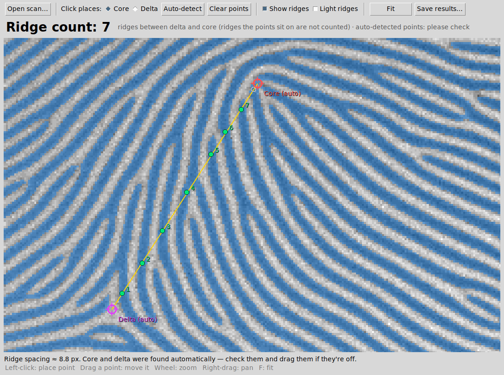

# Hand Infant Scanner: Ridge Counter

Counts the ridges between two points on a fingerprint or palm scan. This is the
classic dermatoglyphic ridge count (Galton–Henry method): the number of ridges
crossed by a straight line from the **delta** (triradius) to the **core**. It
also works for palm counts such as the **a–b ridge count**: put the two points
on triradii a and b.



## Quick start (Windows)

1. **Python.** If `python` works in a terminal, you already have it. Otherwise
   install it from [python.org](https://www.python.org/downloads/) and tick
   *Add python.exe to PATH*.
2. **Download this project.** Click the green **Code** button, then
   **Download ZIP**, and unzip it anywhere (for example, Documents).
3. **Double-click `Ridge Counter.bat`.** The first time, it offers to install
   two free add-ons (numpy and OpenCV). Click **Install** and wait a minute.
   You don't need PowerShell.
4. **Open your scan**, or drag the scan file onto `Ridge Counter.bat`.

## Using the window

| To… | Do this |
|---|---|
| Place the core or delta | Choose *Core* or *Delta* next to "Click places", then left-click the image. After you place the core, the next click places the delta. |
| Move a point | Drag it. The count updates as you move it. |
| Zoom and pan | Use the mouse wheel to zoom and right-drag (or middle-drag) to pan. **F** fits the scan to the window. |
| Check the count | Green numbered dots are the counted ridges. Grey rings are ridges the core or delta sits on, which by convention are not counted. |
| Start over | Click *Clear points*, or *Auto-detect* to bring back the automatic suggestions. |
| Save | *Save results…* writes `<scan>_ridgecount.png` (annotated picture) and `<scan>_ridgecount.json`, and adds a row to `ridge_counts.csv` in the folder you choose. You get one row per saved count, ready for Excel. |

Keyboard: Ctrl+O to open, Ctrl+S to save, C or D to choose core or delta,
+ or − to zoom, F to fit.

## Getting an accurate count

- **Scan resolution.** Infant ridges are fine (about 0.3–0.4 mm apart), so scan
  at **1000 dpi or more** if you can. 500 dpi is the minimum, with ridges about
  6 px apart. After you open a scan, the status bar shows the measured ridge
  spacing. Below about 5 px, the scan is too coarse to count reliably.
- **Check the points.** Auto-detected points, labelled *(auto)*, are only a
  starting suggestion. Zoom in and drag them to the exact places: the core on
  the innermost recurving ridge, and the delta at the centre of the triradius.
- **The endpoint rule.** A ridge isn't counted if the core or delta sits on it.
  Whether a point counts as "on" a ridge can change the total by one, so zoom in
  when you place points and check the grey rings.
- **Light ridges.** If your scanner shows ridges as light lines on a dark
  background, tick *Light ridges*.
- **Blue overlay.** The blue tint shows exactly what the program treated as
  ridge. Where it disagrees with what you can see (smudges, creases, scars),
  trust your eyes and adjust the count.

## Command line (optional)

```
python ridge_counter.py count scan.png                                 # auto-detect core and delta
python ridge_counter.py count scan.png --core 512,388 --delta 301,690
python ridge_counter.py count scan.png --output-dir results --json
```

Options:

- `--light-ridges`
- `--ridge-period PX` overrides the measured ridge spacing.
- `--output-dir DIR` writes the same files as *Save results*.
- `--json`

Run `python ridge_counter.py count --help` for details. To install the add-ons
yourself: `python -m pip install -r requirements.txt`.

## How it works

1. Evens out uneven brightness and contrast across the scan.
2. Measures the ridge spacing from the image's frequency spectrum, so it adapts
   to any scanner resolution.
3. Estimates the ridge direction at every pixel, then sharpens the ridges with
   Gabor filters tuned to that direction and spacing.
4. Separates the print from the background by how ridge-like each area is.
5. Finds cores and deltas from the Poincaré index of the ridge-direction field.
6. Walks the line from the delta to the core and counts the ridges it crosses.
   It bridges pores and small breaks, ignores specks, and leaves out the ridges
   under the two points.

## Accuracy

These figures come from synthetic scans where the right answer is known. The
scans had noise, blur and uneven lighting, with ridge spacings from 5 to 18 px.

- **Straight and circular ridge patterns:** exact on every test line, for
  both dark and light ridges.
- **Realistic loop prints** (with ridge endings, forks, a core and a delta),
  compared with what is visible in the image:
  - About 89% of lines between hand-picked points were exact, and over 99%
    were within one ridge.
  - The core-to-delta line was exact in about 72% of prints and within one
    ridge in 97%.
  - Cores and deltas were found within one ridge-width of their true position.

Errors happen where a ridge ends or forks right on the line, and where a
point sits on the edge of a ridge. That's why the window shows every counted
ridge: have a person confirm any count that matters. This is a research aid,
not a certified clinical device.

## For developers

```
python -m pip install -r requirements-dev.txt
python -m pytest
```

`tests/synthetic.py` generates the synthetic prints. Run
`python -m tests.synthetic` to regenerate `sample_data/sample_loop.png`. The
GUI tests run when Tkinter and a display are available, and are skipped
otherwise.
